<p align="center">
  <picture>
    <source media="(prefers-color-scheme: dark)" srcset="assets/logo/mosaic-horizontal-dark.svg">
    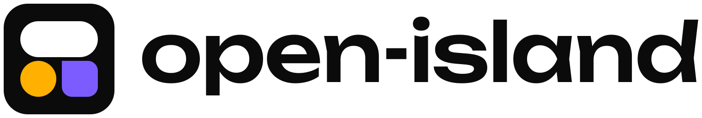
  </picture>
</p>

<p align="center">
  <b>A dynamic island for your desktop.</b><br>
  A little black pill at the top of the screen that shows what matters right now, and gets out of the way the rest of the time.
</p>

<p align="center">
  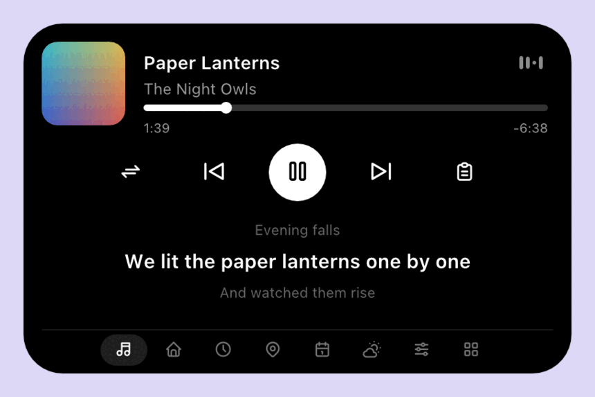
</p>

<p align="center">
  <a href="#install">Install</a> ·
  <a href="#what-it-does">Features</a> ·
  <a href="#works-on">Platforms</a> ·
  <a href="#your-data">Privacy</a> ·
  <a href="docs/guide.md">Full guide</a>
</p>

At rest it is a clock. When something happens it changes shape to show it: the song you are playing, a message that just
arrived, the timer running out. Hover it or click it to open it. When a window covers its place it slides out of the way,
and the pointer at the top edge brings it back.

## What it does

### Music at a glance

The cover, the controls and the lyrics in time with the song, with shuffle and repeat when the player offers them. Closed,
it keeps the title and a small equalizer in view.

<p align="center">
  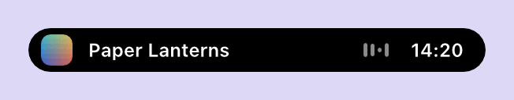
</p>

### Notifications that drip out of the island

Messages drop out as soft cards, up to three at a time, with their buttons and replies. One-time codes show large, and a
click copies them. In a meeting, on a call or while sharing your screen the island stays quiet, then tells you what you
missed. You can also ask for quiet for an hour, or until the lesson ends. A screenshot's card lets you copy its text,
send it to your phone, open its folder or throw it away.

<table>
  <tr>
    <td width="50%">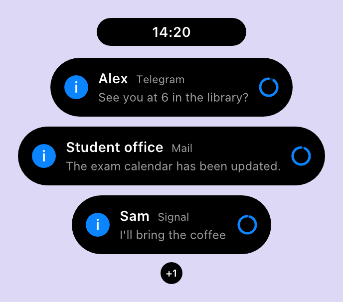</td>
    <td width="50%">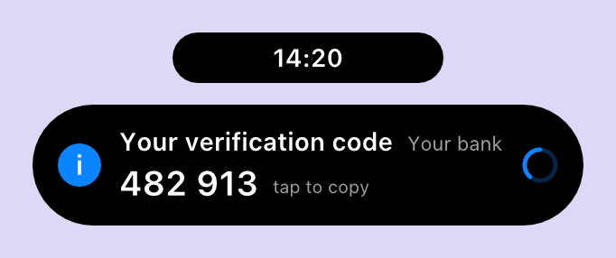</td>
  </tr>
</table>

### Your day, in one place

Classes, appointments, deadlines and to-dos in order, with the time you need to leave to get there. If you like, a card
in the morning and one in the evening sum it up, weather included. Five minutes before a lesson ends it says what comes
next and where, and as an exam gets close the days left show beside the clock (you choose how early). Reminders can wait for a place too: "when I
get home, water the plants".

<table>
  <tr>
    <td width="50%" valign="top">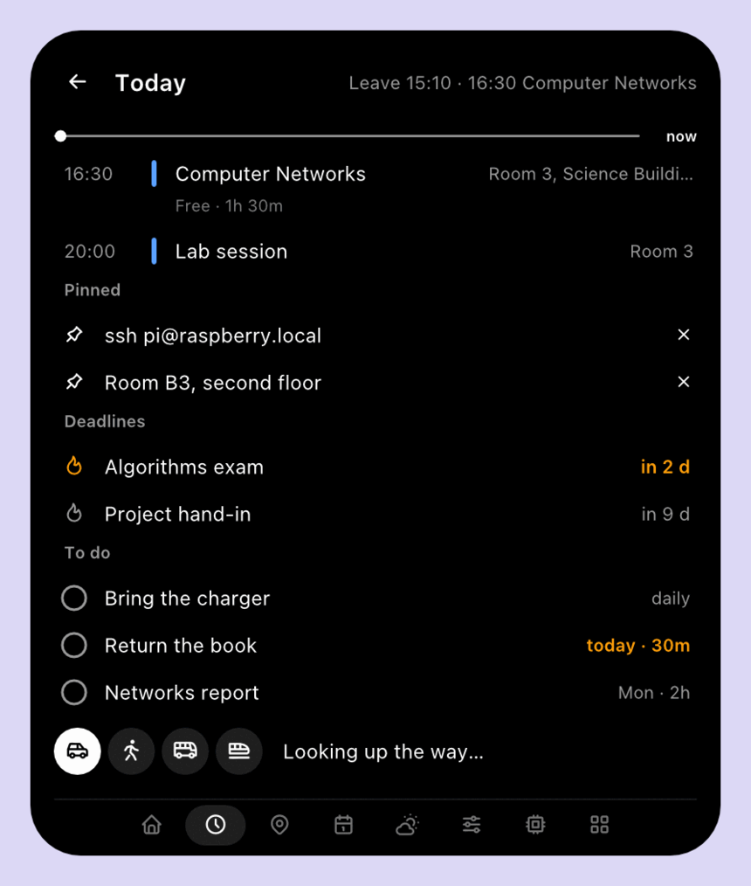</td>
    <td width="50%" valign="top">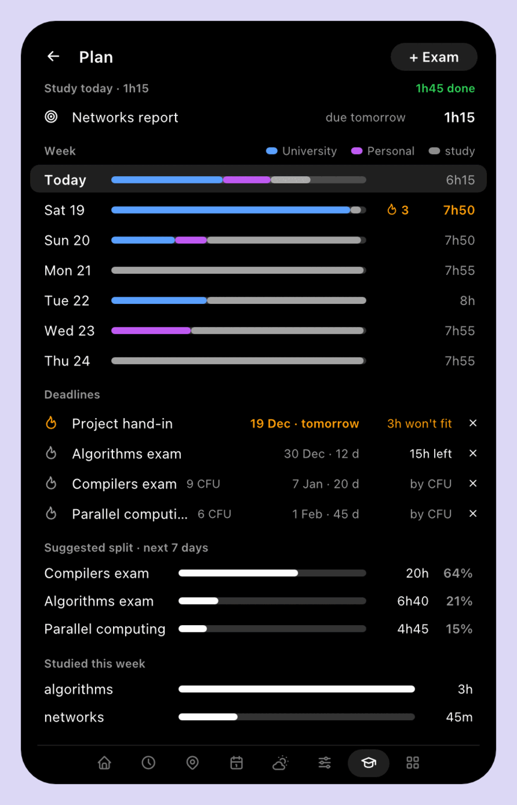</td>
  </tr>
</table>

### A study plan that fits your calendar

Add your exams with their date and either their credits or the hours you expect to need. The island suggests what to study
each day: more on free days, less on busy ones, and never more than the day can hold. You choose when your study day
starts and ends, weekday by weekday, when you break for lunch, and which days are off. Each of your calendars keeps its own colour.

Press ▶ on something to study and a Pomodoro starts: notifications wait for the break and the time is logged by itself. Under
each exam with hours, the island says whether your pace of the last days gets you there.

Mark the apps that pull you away, and the island tells you when you have been on them too long during study hours. A week
view shows where your time went, app by app.

### Timers, and a bar you can talk to

Several countdowns at once, a Pomodoro and a stopwatch. Open the command bar (give `open-island msg bar` a keyboard
shortcut) and just type:

| Type | And you get |
|---|---|
| `10m tea` | a ten-minute timer |
| `remind friday 9:00 call the office` | a reminder |
| `todo report due fri` | a task for your list |
| `exam 15 dec Algorithms 9cfu` | an exam in your study plan |
| `dnd 1h` | an hour of quiet |
| `remind me when i get home water the plants` | a reminder that waits until you are there |
| `20% of 150` | the answer, ready to paste |
| `5 km in mi` | a conversion |
| `emoji fire`, `symbol implies` | emoji and symbols to pick and paste |

<table>
  <tr>
    <td width="50%">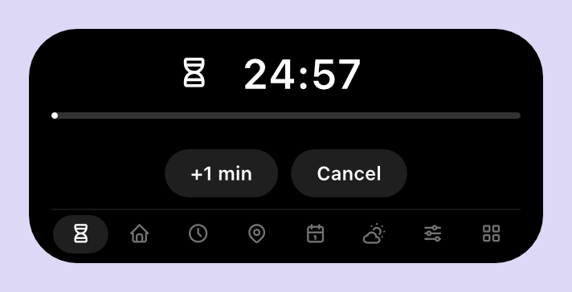</td>
    <td width="50%">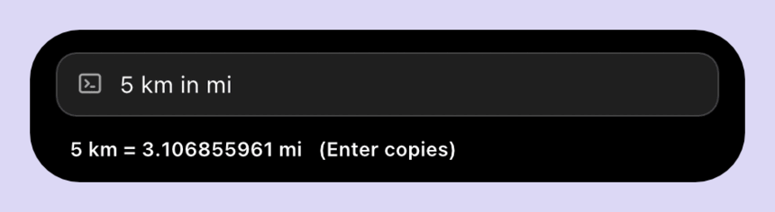</td>
  </tr>
</table>

### Weather and the way there

Rain warnings before you leave, the forecast for the day, and a map with the way to your next event: by car, on foot, by
public transport or by train. If you take the same train every day (Trenitalia, in Italy), it tells you when it is late.

<table>
  <tr>
    <td width="50%">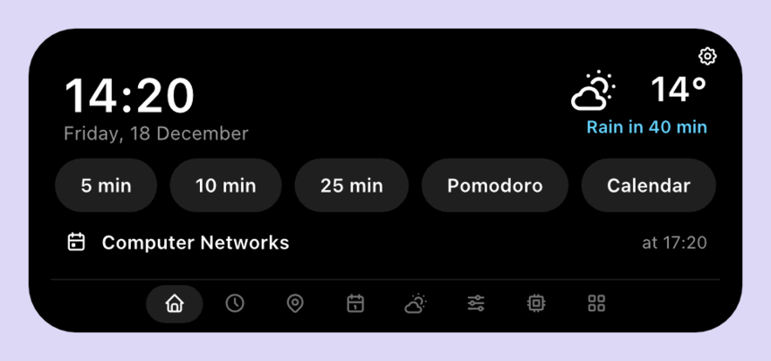</td>
    <td width="50%">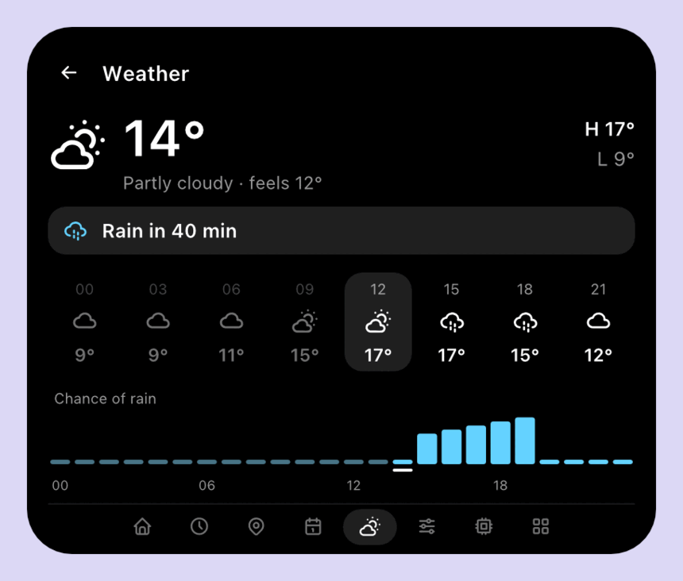</td>
  </tr>
</table>

### Controls within reach

Volume, brightness, Wi-Fi, Bluetooth, do not disturb and keep awake. Choose where the sound plays, set the volume of each
app, and see your headphones' battery when they connect.

<table>
  <tr>
    <td width="50%">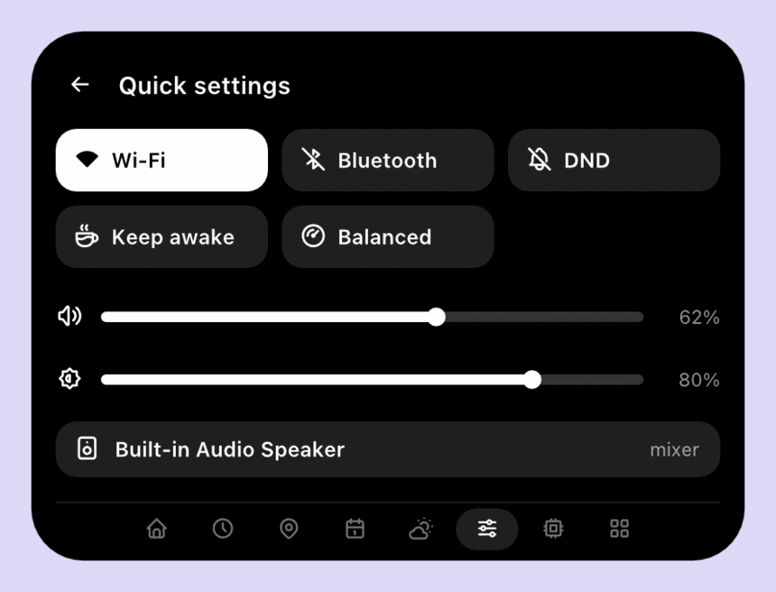</td>
    <td width="50%">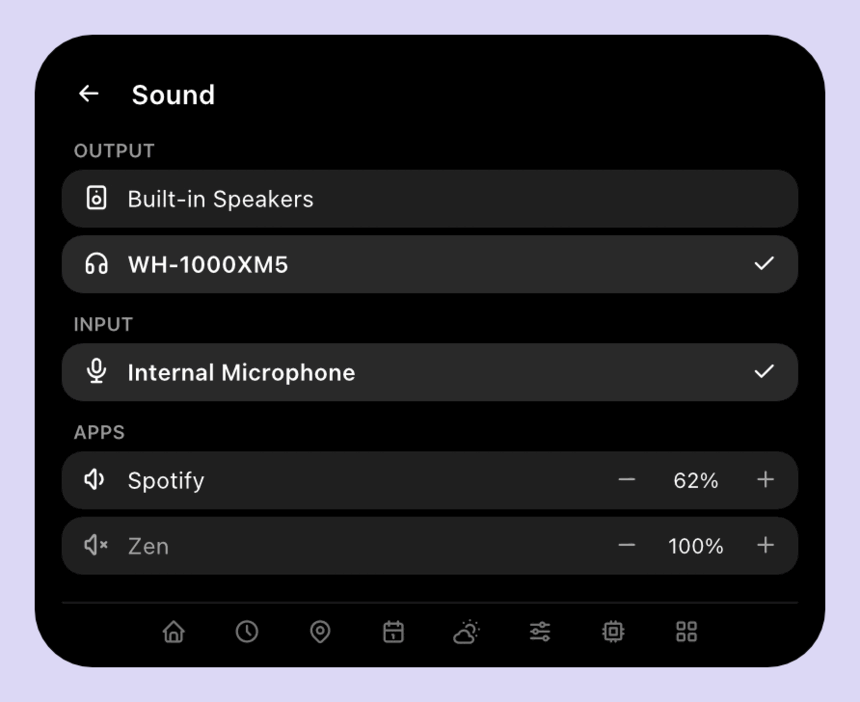</td>
  </tr>
  <tr>
    <td width="50%">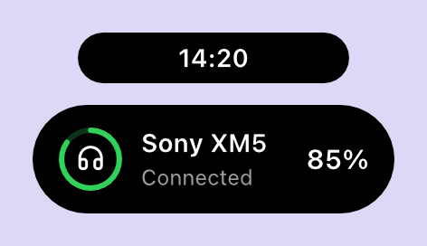</td>
    <td width="50%">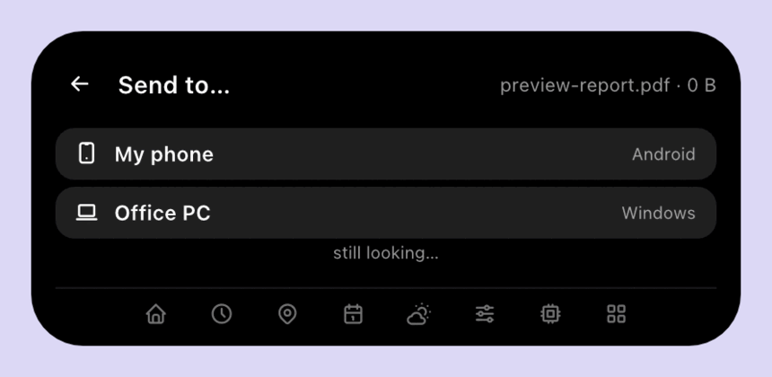</td>
  </tr>
</table>

### And the small things

- **A shelf for files** (Linux): drop them on the island, and drag them out again where you need them.
- **Send files** to your phone or another computer nearby (with [LocalSend](https://localsend.org)), and receive them on
  Linux once you switch that on: you accept each transfer from its card.
- **Caps Lock and keyboard layout:** a short notice when they change (Linux; the layout on niri).
- **Clipboard history**, with the entries you want to keep pinned.
- **Downloads and long jobs** beside the island, as a drop of liquid: it fills up with a job that says how far it is,
  and sloshes while your browser downloads a file.
- **A heads-up** when a program is slowing the computer down, or the network stops working.
- **Live weather:** the weather outside shows inside the pill: sun, clouds, fog, rain, snow, and at night the stars
  and the moon in its phase. Snow piles up at the bottom, and rain leaves drops on the glass.
- **Moves with the music:** the edges of the small pill ripple like a liquid.
- **Birthdays** from your calendars, with a burst of confetti.
- **Battery:** plug in and it pours like liquid, with the time to full.
- **A second screen** (niri): choose to extend or use only one, and it comes back by itself if you do not confirm.
- **Administrator passwords** (Linux, off until you [switch it on](docs/guide.md#administrator-passwords-linux-off-by-default)):
  a drop falls from the island and becomes the request, and with [Gaze](https://gaze.gundulabs.com) your face can answer it.
- **Camera and microphone**: you see when they are in use, and mute the microphone with a click or a key.
- **Make it yours:** most things can be switched on or off from the options page.

<p align="center">
  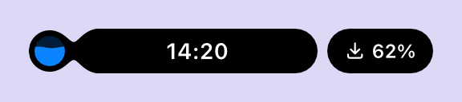
</p>

### For people who like the terminal

Your scripts can talk to the island: show progress, ask a yes-or-no question, or say that a job is done. Coding agents
such as Claude Code can use it to tell you when they need you.

```sh
open-island ok "Build finished"
open-island run make test
```

<p align="center">
  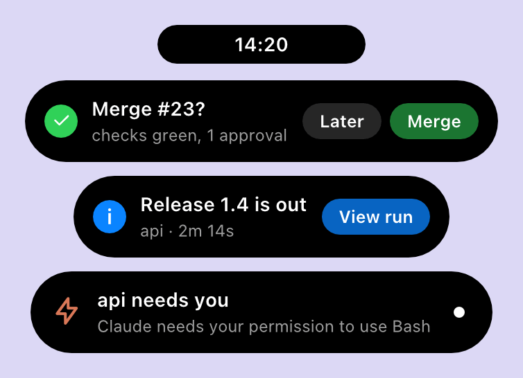
</p>

## Works on

| System | Status |
|---|---|
| **Linux** (Wayland) | Ready for daily use. Developed on [niri](https://github.com/YaLTeR/niri); other desktops may behave differently. |
| **Windows** | In testing. Most features are there; a few are Linux only. |
| **macOS** | Experimental: it has never been tried on a Mac, and several features are missing. |

The [full guide](docs/guide.md#status) says what works where, feature by feature.

## Install

There are no ready-made downloads yet, so you build it yourself. You need [Rust](https://rustup.rs) and a graphics card
with up-to-date drivers; on Windows also the Visual Studio C++ build tools, which the Rust installer offers.

### Linux

```sh
git clone https://github.com/SpanishInquisition49/Open-Island.git
cd Open-Island
cargo install --path crates/app

open-island doctor          # checks what works on your computer and what is missing
open-island autostart on    # start it with your session
open-island                 # start it now
```

> **Note:** the island takes over your desktop notifications and stops the program that was showing them. To keep your
> current one, add `"take_over_notifications": false` to `~/.config/open-island/config.json`.

### Windows

```powershell
git clone https://github.com/SpanishInquisition49/Open-Island.git
cd Open-Island
cargo build --release
.\target\release\open-island.exe
```

Something looks wrong? The [Windows test notes](docs/windows-test.md) say what to check and what to report.

## Set it up

Open the island and click the **gear** to add your calendars (iCloud, Google, Outlook and most others), choose your
weather location and pick a sound. The **options** page switches features on and off.

## Your data

- No sign-up, no ads, no tracking.
- Some features ask public services for what they need: weather, maps, directions, trains, lyrics and exchange rates.
  Each can be switched off or left unused.
- The weather, the map and place reminders follow your computer's location. You can set a fixed place instead. The places
  you save stay on your computer.
- Your clipboard history stays in memory, apart from what you pin, and one-time codes are kept out of it.

The guide lists exactly [what leaves your computer](docs/guide.md#what-leaves-the-machine).

## Credits

open-island began as a port of a dynamic island plugin for the Noctalia shell. The notification cards are modelled on
[drip](https://github.com/jrnxf/drip), and the icons are [Tabler](https://tabler.io/icons). See
[third-party notices](THIRD-PARTY-NOTICES.md).

Released under the [MIT licence](LICENSE).
